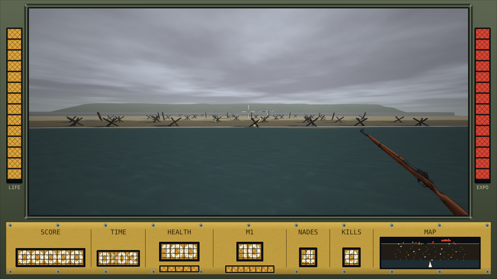
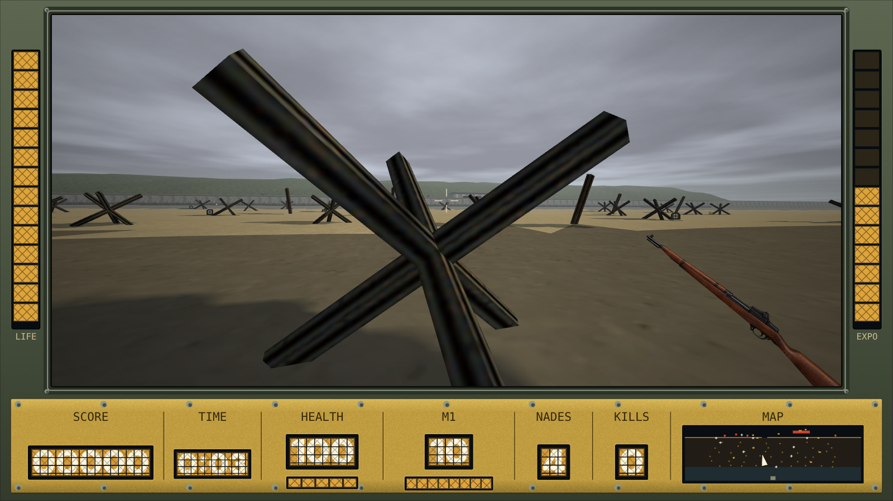
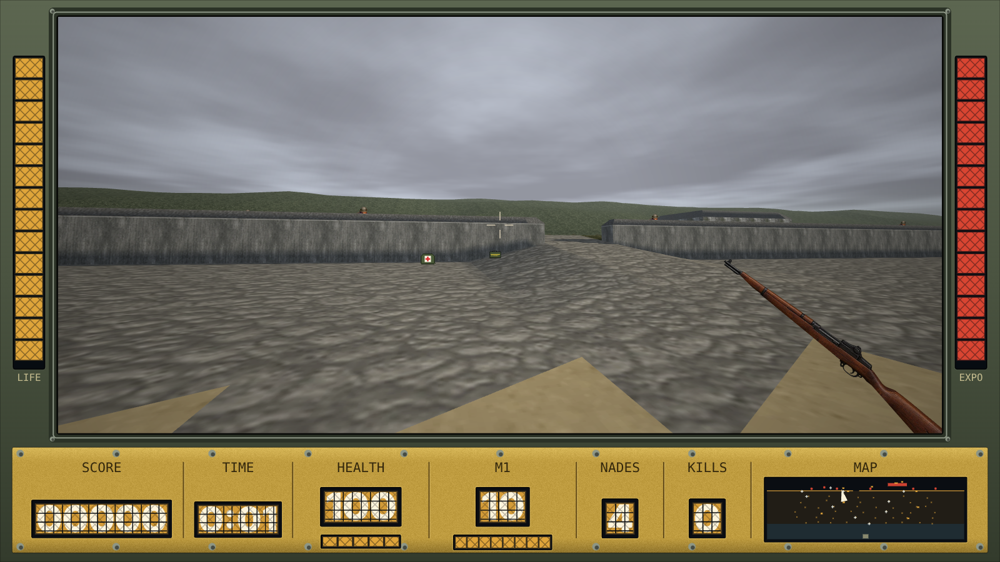
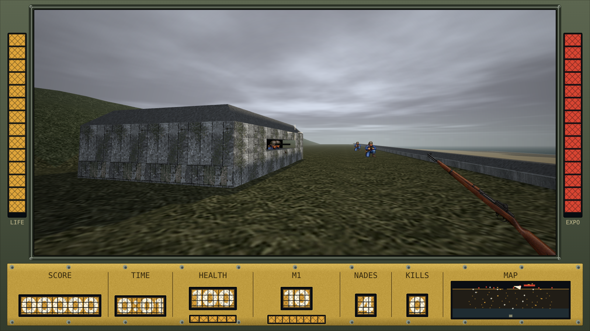
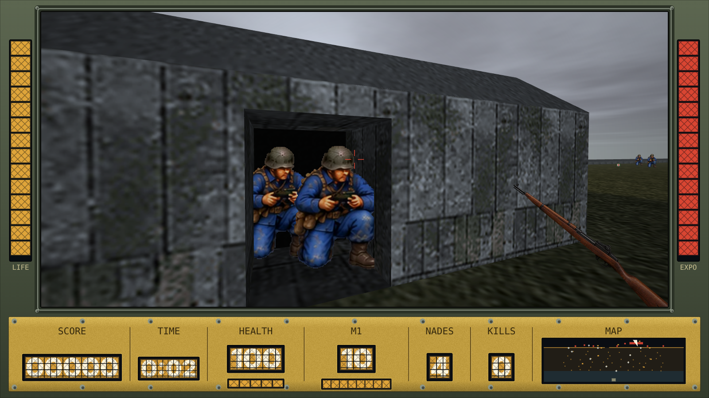
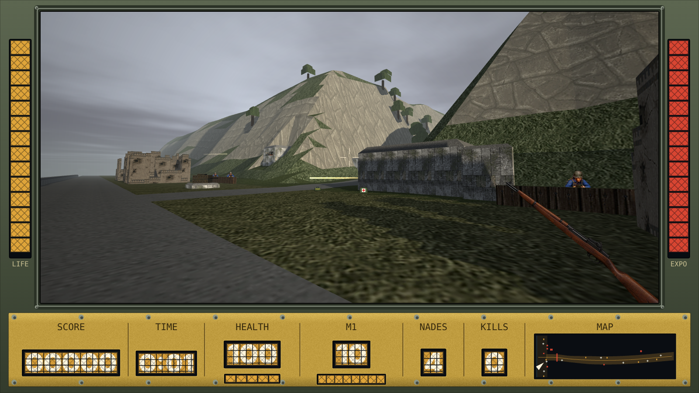
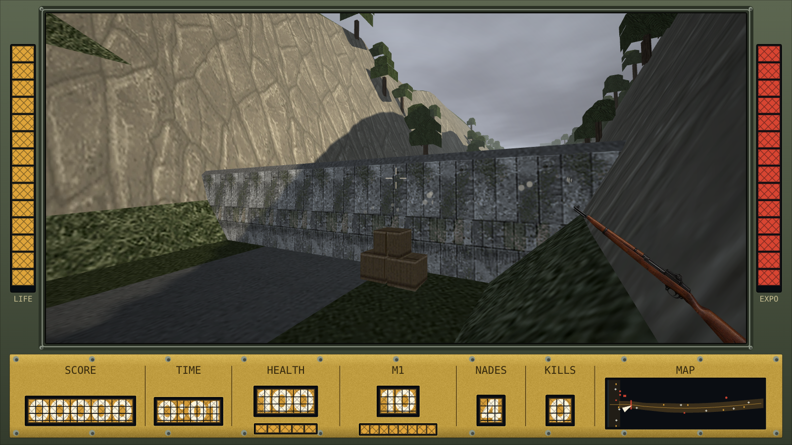
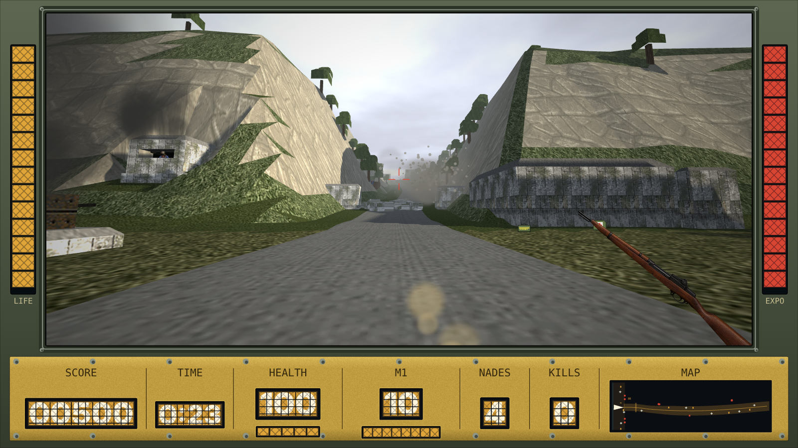
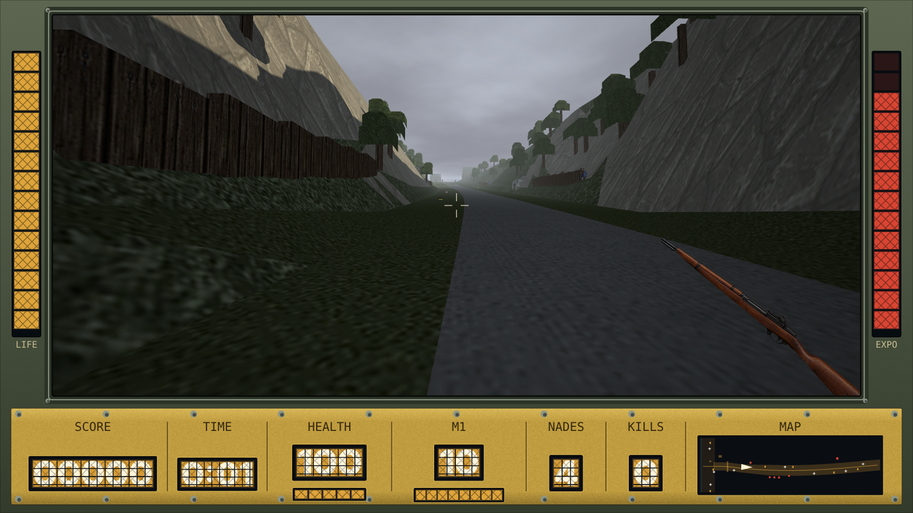
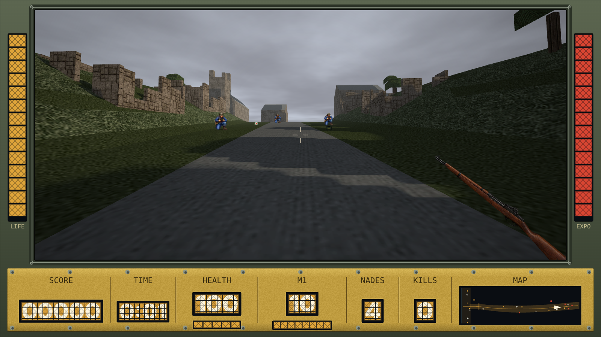

# NORMANDY

First-person assault on Omaha Beach, 6 June 1944, in two levels.

1. **Dog Green.** The ramp drops, you wade in, run hedgehog to hedgehog under a sweeping MG42, shelter at the seawall, go through the gap and take the casemate: grenade, rifle or bayonet.
2. **D-1, the Vierville draw.** Early afternoon. Silence the turret and the MG nest on the beach flat, set the fuse on the engineers' TNT at the anti-tank wall, get clear, then fight up the draw under mortar fire to the Vierville crossroads.

Win the beach and Enter takes you straight up the draw with your score, kills and grenades. Your clips are topped up to at least six.

### Dog Green

<table>
  <tr>
    <td align="center"><br>Ramp down</td>
    <td align="center"><br>Hedgehog cover</td>
  </tr>
  <tr>
    <td align="center"><br>The seawall and the gap</td>
    <td align="center"><br>The casemate</td>
  </tr>
  <tr>
    <td align="center" colspan="2"><br>The rear door</td>
  </tr>
</table>

### D-1, the Vierville draw

<table>
  <tr>
    <td align="center"><br>The beach flat</td>
    <td align="center"><br>The wall and the TNT</td>
  </tr>
  <tr>
    <td align="center"><br>1,100 lb of TNT</td>
    <td align="center"><br>Up the draw</td>
  </tr>
  <tr>
    <td align="center" colspan="2"><br>The head of the draw</td>
  </tr>
</table>

One self-contained HTML file, built from `game.html` plus assets.

## Engine

- **Renderer:** WebGL2 when the browser has it: the same world, sun shadows, fog, sky and sprites drawn at the screen's own resolution with filtered textures, its canvas under the HUD canvas. F sets the resolution (half, three-quarters, full). The sky there is a procedural overcast deck (fbm noise on a cloud plane, drifting, coloured from the Freedoom sky); the software renderer keeps the Freedoom sky. The crosshair pick runs on the CPU against the sprites' pixels, with a window tuned to the software renderer's hits. Without WebGL2, or with `?r=soft`, the software rasterizer below takes over.
- **World:** DECKRUNNER's solid-hull software rasterizer: low-res z-buffer, perspective-correct mipped Freedoom textures, sun shading against a horizon-height shadow map. Fog goes to haze instead of black, and a cylinder sky sits behind it. Each level is a triangulated heightfield on a non-uniform grid. The draw's grid rows slide sideways with the road (`LV.shift`), so the road edges and benches follow its curve. On that heightfield sit boxes, bevel-top concrete, oriented beams and roofless ruins.
- **Levels:** each level is an entry in `LEVELS` that owns its grid, heights, ground textures, build, spawns, bounds, checkpoint, map and per-frame rules (`tick`). The engine rebuilds the world when you change level. Machine guns and casemates are objects (`MGS`, `EMPS`), so a level can have any number. Riflemen hold a patrol line in any direction, so they can stand along the beach or up the draw.
- **Soldiers:** 8-direction billboards, drawn into the same z-buffer. Parapets hide their legs. The figures come from a painted sheet (`src/soldier_paint_v1.png`): `src/soldier_paint_v1.json` names the figure for each state in five views (S SW W NW N; SE E NE are mirrors) and fits each pose to the height of the pixel sheet's frame, so targets stay the size the game was balanced on. `tools/paint_frames.py SHEET --index OUT.png` numbers a sheet's figures. States the map leaves out fall back to the pixel sheet, and three sizes are stored, the finest used as soon as it covers the screen. `tools/build.py --soldiers soldier_blue` builds the pixel-sheet version as `soldier_blue.html`.
- **HUD:** Bounty Hunter's frame, warmed to amber. LIFE and EXPO columns; SCORE · TIME · HEALTH · M1 (8-round en-bloc, pings on the last round) · NADES · KILLS · MAP. On D-1 the map is turned on its side: sea on the left, Vierville on the right. Phones in portrait get a thumb deck under the view.
- **Rifle in hand:** `tools/gun.py` cuts the left-side view out of `src/m1_ref.png`, drops the sling and warps it in perspective into the old drawn rifle's box, so the muzzle flash and bayonet stay on the muzzle. Without `build/gun.png` the game draws its old pixel rifle.
- **Sound:** ZzFX core, as in DECKRUNNER. D-1 adds the mortar whistle.

## Rules that matter

Both levels:

- Out of clips with the rifle empty, the bayonet goes on: fire becomes a lunge that takes the soldier in front of you within 2.4 m. The M1 slot reads BAY. Any ammo can puts you back on the rifle.
- First-aid packs give +50 health. Ammo cans give +3 clips (max 12) and +2 grenades (max 6); you only pick one up if you need it.
- Health regenerates once nothing has seen you for 3 seconds.
- A casemate falls to a grenade through its slit, or to shooting both crew in it (the loader takes the gun 3 s after the gunner falls).

Dog Green:

- The MG42 bursts and pauses. With you in its arc and in sight, it tracks you with lag; otherwise it sweeps the beach. Its arc is ±60° about seaward.
- A crouched player behind a hedgehog is covered from the MG. Standing behind one is not.
- The seawall base is dead ground for the MG, and for the riflemen if you crouch.
- The casemate has a gunner and a loader, seen head and shoulders in the slit. The third way in is the rear door: it opens as you reach it and brings both crew to the doorway to fight.

D-1:

- The R35 turret on its Tobruk turns all the way round and covers the wall's foot. It has no crew you can see: a grenade landing within 2 m of it kills it, and a flat throw that rolls in is enough.
- The MG nest is dug into the bluff west of the mouth and looks out over the flat, not back at the wall. Shoot its crew through the slit from the road.
- The TNT sits at the wall's foot. Crouch beside it for 3 seconds to set a 20-second fuse. The blast hurts anything within 26 m that it can see. The lee of the H677 or the promenade is safe; open ground 12 m out leaves you on single figures.
- Once the wall is down, the mortars on the west rim drop a round near you every 7 or 8 seconds. Each one lands closer while you stay put, and moving 8 m resets the bracket. Kill the two men in the pit to stop them.
- The draw's sides are too steep to climb. Riflemen hold benches behind timber parapets.
- A tunnel mouth in the east side keeps sending men out (two at a time, five in all) while you are near it. A grenade at the mouth closes it.
- Checkpoints: the wall, once it is down, and the trenches at mid-draw. The level ends at the crossroads at the head of the draw.

## History

D-1 follows the record with the distances compressed: the real road from the wall to the village is several times longer.

- **Kept from the record:** D-1 was the only paved exit off Omaha, climbing a small wooded valley to Vierville-sur-Mer. A minefield and a concrete anti-tank wall blocked its mouth. WN72 held the exit with an 88 mm Pak 43/41 in an H677 casemate firing along the beach, MG casemates and an R35 turret on a Tobruk. WN71 sat on the west heights with an SK twin-MG casemate and two 8 cm mortars.
- **The timeline:** naval fire, the Texas's 14-inch guns among it, silenced the strongpoint between 1200 and 1300. Defenders still came back into positions thought neutralized, through tunnels that ran inland. The 121st Engineer Combat Battalion blew the wall with 1,100 lb of TNT (one veteran's account credits the 147th), and the road was open to Vierville around 1700. German spotters used Vierville's church steeple, and the destroyer USS Harding shot it off during the first two days.
- **Invented for play:** the turret on the flat, the tunnel mouth in the draw, the benches and the mortar pit's place on the west rim are all positioned for gameplay.

Sources: [WN72](https://www.dday-overlord.com/en/d-day/atlantic-wall/strongpoints/wn-72) and [WN71](https://www.dday-overlord.com/en/?p=136053) (D-Day Overlord); [Omaha Beachhead](https://www.ibiblio.org/hyperwar/USA/USA-A-Omaha/USA-A-Omaha-5.html), ch. 5 (US Army, American Forces in Action); [121st Engineer Combat Battalion after-action report](https://www.dday-overlord.com/?p=140802); [Exit D-1 at Vierville](https://strijdbewijs.nl/normandie7/Vierville-s-M.htm) (Strijdbewijs); [USS Harding and the Vierville steeple](https://www.defensemedianetwork.com/stories/d-day-horace-flack-margaret-flack-and-the-uss-harding/3/) (Defense Media Network).

## Build

```
git clone --depth 1 https://github.com/freedoom/freedoom.git ../freedoom
python3 tools/slice_sprites.py src/1000011203.png build/soldier_blue --add down=src/down.png:150 --add fall=src/fall.png:150 --debug build/dbg_blue.png
python3 tools/slice_sprites.py src/1000011203.png build/soldier_blue_hi --px 1 --add down=src/down.png:150 --add fall=src/fall.png:150
python3 tools/paint_frames.py src/soldier_paint_v1.png src/soldier_paint_v1.json build/soldier_paint
python3 tools/gun.py src/m1_ref.png build/gun.png
python3 tools/build.py ../freedoom
```

This writes `index.html` (the playable page, also copied to `dist/index.html`) and `dist/artifact.html` (fragment for the Claude artifact). Commit `index.html`: the arcade repo's `.gitignore` drops anything under `dist/`. The build needs Pillow, numpy and scipy.

`slice_sprites.py` finds cells as connected components and assigns each one to the nearest row and column label, because the sheet is not on a fixed grid. It removes red spatter, then anchors each frame helmet-over-feet. The debug sheet shows every frame on its anchor.

## Test

```
python3 tools/shots.py build/shots 1280x800
python3 tools/shots.py build/shots_p 412x880
python3 tools/shots.py build/shots_d1 1280x800 d1
```

`window.__qa` exposes `play()`, `level(n)`, `stage(n)`, `next()`, `place(x, z, yaw, pitch, crouch)`, `advance(sec)`, `freeze(bool)`, `grenade()`, `fire()`, `pick()` and `state()`; `dbg()` hands back the live lists (`MGS`, `EMPS`, `game`, `pl`).

## Stages

Skip ahead for testing or practice. Stages are numbered across both levels.

| # | name | level | start |
|---|---|---|---|
| 0 | boat | Dog Green | in the LCVP, ramp up |
| 1 | beach | Dog Green | off the ramp in the shallows |
| 2 | mid | Dog Green | crouched behind a second-row hedgehog |
| 3 | seawall | Dog Green | crouched at the seawall base (checkpoint set) |
| 4 | gap | Dog Green | through the gap, riflemen to your left |
| 5 | bunker | Dog Green | beside the casemate |
| 6 | flat | D-1 | the briefing, then the promenade |
| 7 | wall | D-1 | in front of the wall, the turret and nest still firing |
| 8 | draw | D-1 | through the breach, the mouth silenced (checkpoint set) |
| 9 | head | D-1 | under the mortar pit, near the head of the draw |

Choose with `?stage=8` or `?stage=draw` (local file, GitHub Pages), `?level=2` for the start of D-1, `#stage8` or `#draw` (also works for the Claude artifact link), the 0–9 keys on the title screen, or by tapping the STAGE line on a phone. Add `&start=1` (or `?start=1`) to skip the title screen.

Level skip: L on the title, win or down screen (or a tap on the LEVEL line on a phone) picks the next level's first stage; L while paused (P) drops you straight into the next level.

## Controls

WASD move · mouse, Q/E or arrows look (mouse works without pointer lock: move to look, rest at the view's edge to keep turning) · click / Space fire · Alt or C crouch (crouch at the TNT to set the fuse) · G (or right-click) grenade · R reload · M sound · P pause · V post pass · F detail (LO/MED/HI render resolution, remembered; `?q=hi` in the URL sets it).
Touch: left thumb moves, right thumb looks; FIRE / NADE / DUCK. SWAP flips the sides for left-handers.

## Credits

Textures: Freedoom (BSD). Sound synthesis: ZzFX by Frank Force (MIT).