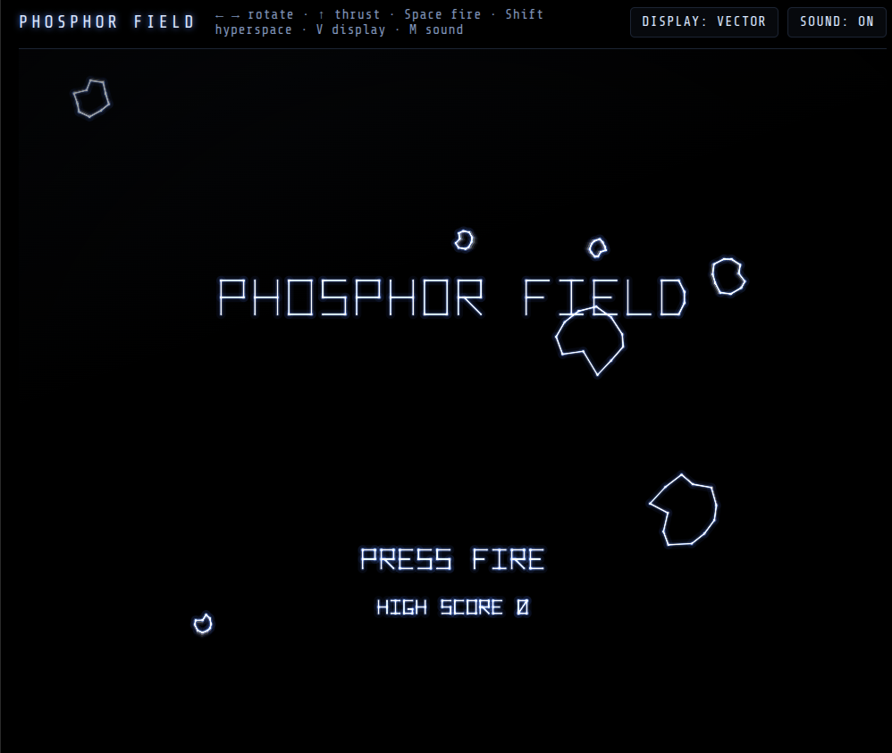
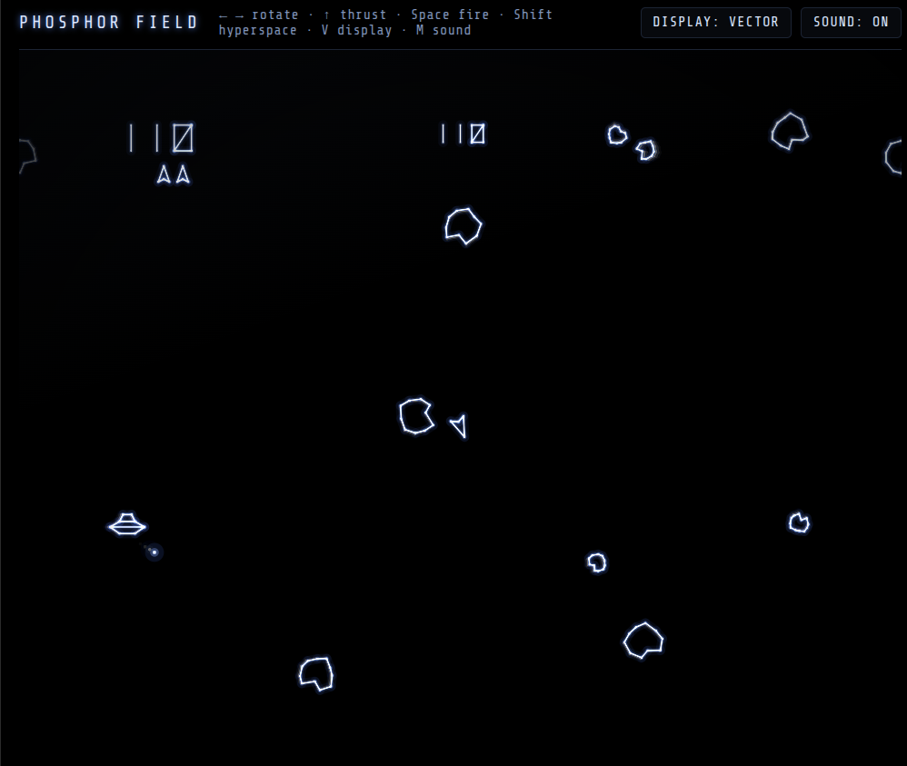

# PHOSPHOR FIELD

A rock-field shooter in the style of the 1979 black-and-white vector cabinets, built to look like an XY monitor rather than an LCD. Press **V** to flip to a simulated LCD and see the difference.

<table>
  <tr>
    <td align="center"><br>Attract mode</td>
    <td align="center"><br>Wave 2, the large saucer</td>
  </tr>
</table>

One self-contained HTML file. No build step, no libraries.

## Controls

| Action | Keyboard | Touch |
|---|---|---|
| Rotate | ← → or A D | ◀ ▶ |
| Thrust | ↑ or W | THRUST |
| Fire | Space or Enter | FIRE |
| Hyperspace | Shift, ↓ or S | HYPER |
| Display: vector / LCD | V | DISPLAY button |
| Sound on / off | M | SOUND button |

Fire or a tap on the screen starts a game. The touch pad appears on touch devices.

## Rules

- Rocks split large → medium → small: 20, 50 and 100 points.
- Four of your shots on screen at most, one per press.
- The large saucer (200) fires at random. The small saucer (1000) aims at you and gets more accurate as your score climbs. Above 10,000 the small one is the usual visitor.
- Saucer shots break rocks too, for no score.
- Hyperspace drops you at a random spot after half a second, with a 1 in 8 chance of not surviving the jump.
- Bonus ship every 10,000. Each wave starts with two more large rocks than the last, up to 11.
- After a loss you respawn in the centre once it's clear.

## Rendering

The point of the game. Every frame builds a display list of line segments and points in a 1024×768 field, then draws it two ways.

**Vector.** Each segment is stroked four times with additive blending: a wide faint blue halo, two mid glows, then a thin white core. Short segments draw brighter than long ones, the way a beam that moves more slowly deposits more energy, and every vertex gets a small bright dwell dot. Shots and sparks are point plots with their own bloom.

That frame then goes through a WebGL phosphor buffer, two ping-pong textures where each pixel becomes:

```
out = max(prev * keep - bias, current)
```

`keep` gives the exponential decay, `bias` pulls the dim tail down to true black, and `max` stops anything that sits still from building up to white. The usual 2D-canvas approach (drawing translucent black over the last frame) stalls a few 8-bit levels above zero and leaves a permanent grey haze with ghosts in it; the bias is what fixes that. Without WebGL the game falls back to the 2D method.

Tuning, near the top of the script:

| Constant | Default | Effect |
|---|---|---|
| `PERSIST_S` | `0.045` | Seconds for a lit pixel to fall to 10%. Higher gives longer trails. |
| `PERSIST_BIAS` | `6 / 255` | Linear drop per 60 Hz frame (scaled by frame time). Higher trims trails shorter. |
| `PASSES` | 4 passes | Width, alpha and colour of each stroke pass, halo to core. |

**LCD.** The same display list drawn at 320×240 on a lit grey background, then scaled up with no smoothing. That shows the two things the cabinet LCDs lose: black that isn't black, and lines that stair-step.

It looks best on an OLED screen in a dark room. An LCD panel puts its own backlight floor under the vector mode.

## Sound

Web Audio, synthesised: the two-note heartbeat that speeds up through a wave, a fire blip, a noise burst per explosion sized to the rock, filtered-noise thrust and a warbling saucer tone (higher for the small one). Audio starts on your first key or tap.

## Saved data

High score only, in `localStorage` under `phosphor-hi`.

## Network use

Loads Share Tech Mono from Google Fonts for the top bar and falls back to the system monospace font without it. The game itself needs no network.

## Credits

An original take on the vector-cabinet style. The rock outlines, saucer, ship, stroke font and sounds are drawn or generated in code here; nothing is taken from the 1979 game. Not affiliated with or endorsed by Atari.
