# Tauri Reach

Prototype for a space fighter game set inside a nebula around a young, violently active star: a volumetric nebula you can fly through, a star that throws plasma through it, and two bandits to dogfight with kinetic guns. The star's interference hits everyone's sensors, yours and theirs.

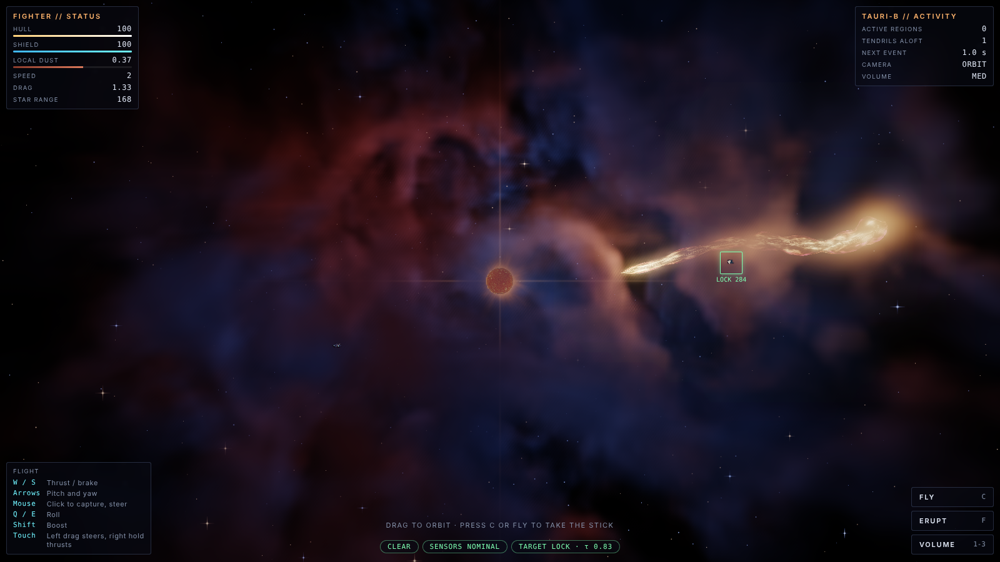

## Sorties

The page opens on the briefing for the furthest sortie you have unlocked. Each sortie has its own splash: the codename, the briefing, the objective and conditions, and the target turning in its own view over the live nebula. Clear a sortie to unlock the next; progress is kept in the browser. To skip ahead, `?sortie=N` opens on sortie N (1–5) with it and the ones before it unlocked, the way Deckrunner's `?wave=N` works; that skip isn't saved. `?all` unlocks everything, and `?lab` goes straight to free flight.

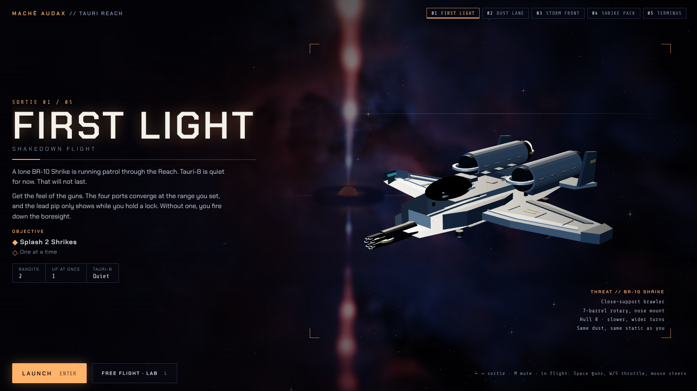

| # | Sortie | Objective | Up at once | Tauri-B |
|---|---|---|---|---|
| 1 | First Light | Splash 2 Shrikes (8 hp) | 1 | Quiet: eruptions every 13–19 s |
| 2 | Dust Lane | Splash 4 Shrikes | 2 | Restless: 9–14 s |
| 3 | Storm Front | Splash 4 Shrikes | 2 | Outburst: 3.5–6 s |
| 4 | Shrike Pack | Splash 6 hardened Shrikes (13 hp) | 3 | 8–13 s |
| 5 | Terminus | Kill the 4 reactors and watch the station fall into the star | 2 escorts, 1 at a time | 10–15 s |

- **Briefing.** Enter or Launch flies it; ← → (or the chips along the top) pick another unlocked sortie; L drops into free flight.
- **In flight.** The objective is the first chip on the bottom strip. Only as many bandits are put up as are left to splash, and one lost to the star is replaced. C, F and K are lab-only during a sortie; Abort sortie (bottom right) returns to the briefing.
- **Losing the fighter** ends the sortie: a death cam circles the wreck, then the debrief. The debrief names what got you: the Shrikes' guns, the star itself (flying into Tauri-B is fatal), plasma, a jet, a shock front, or the station's hull. **Debrief** shows time, kills (or reactors), hull and accuracy: Enter goes on, R flies it again, B returns to the briefing.

**The briefing model.** The splash shows the BR-10 Shrike in full detail: 158 parts, about 10.5k triangles, with a stepped armored hull, cheek plates, a seven-barrel chin cannon, elevated nacelles with intake fans, and twin tails. It is too heavy for the dogfight, where the lighter in-game bandit stands in for it. It loads from `assets/br10-shrike.glb`, rebuilt by `assets/build_shrike.py` (trimesh). Its vertex colors are converted from sRGB, and each part gets a material by name: glowing exhausts, aux and RCS emitters, double-flash navs, and a dark glass canopy. Shrike Pack shows a three-ship echelon, and Terminus shows the station. If the file can't load, the briefing falls back to the in-game bandit mesh.

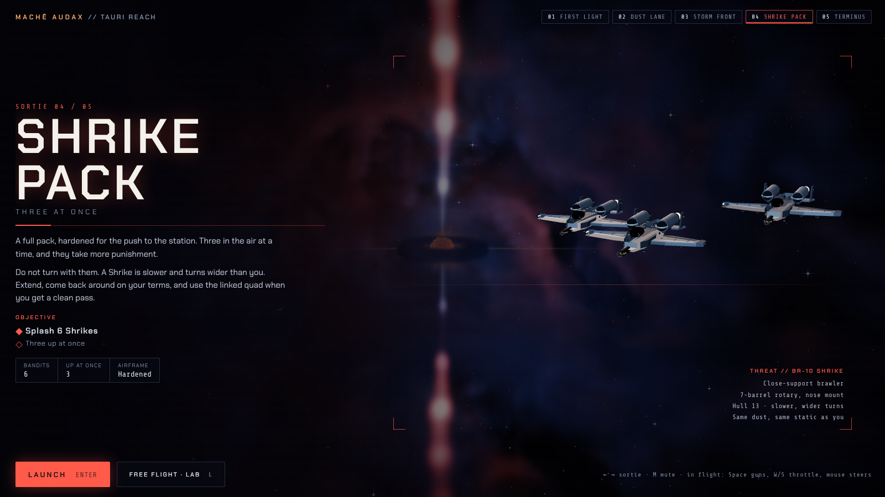

## Controls

| Input | Action |
|---|---|
| C or Tab | Switch between orbit camera and flying the fighter (lab only) |
| V | Cockpit or chase view while flying (cockpit is the default) |
| H | Hide the controls card |
| F | Trigger an eruption now (lab only) |
| 1 / 2 / 3 | Volume quality: low, medium, high |
| W / S | Throttle up / down. The ship always flies forward; the throttle sets cruise speed (34–95) |
| Arrows | Pitch and yaw |
| Mouse | Click to capture, then steer |
| Q / E | Roll |
| Shift | Boost |
| Space / left mouse | Guns |
| G / right mouse | Alternating pairs ↔ linked quad |
| Wheel / `[` `]` | Gun convergence (120–500) |
| T | Next target |
| M | Mute |
| P | Pause (the sim stops, rendering continues, so screenshots stay clean) |
| K | Launch the station assault (lab only; the Station button does the same) |
| , / . | Game speed down / up 10% (also the Game speed slider, 40–160%, remembered per browser) |
| Touch | Orbit: drag and pinch. Fly: left half drag steers, right half drag up/down is the throttle, Fire button shoots |

## Cockpit view

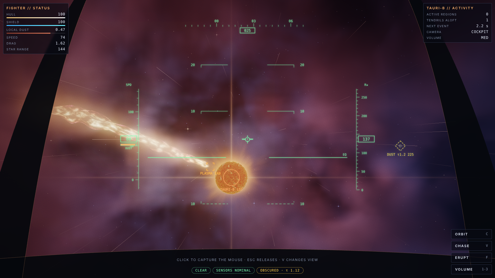

The cockpit HUD is drawn on a 2D canvas over the WebGL view:

- **Pitch ladder.** Space has no horizon, so the ladder is referenced to the star's equatorial plane. It rolls with the airframe.
- **Heading tape.** Bearing around the star's spin axis.
- **Side tapes.** Speed on the left, with a dust-density bar. Range to the star on the right.
- **Markers.**
  - A flight-path marker shows where the ship is actually going, not where the nose points.
  - The star and the bandits are marked on screen, and get edge arrows when off-screen.
  - Plasma threats are marked at the closest point on each live tendril.
  - Eruption warnings sit on the active region.
- **Target diamond.** Solid with a lock ring (its hit points) when the line of sight is clear. Dashed with the optical depth when dust blocks it, or `STATIC` when interference whites out the sensors.
- **Lead pip.** Where to put the boresight so a round meets the target. It turns red when it sits on the boresight inside gun range.
- **Guns.** Heat bar, mode and convergence under the boresight, and a hit marker around it.

Static from the ionized sheath jitters the symbology and makes it drop out, but the canopy frame stays still. Plasma contact and hits shake the eye point.

Near-field dust streaks sell speed and density from inside the volume. 700 motes wrap in a box around the camera, each drawn as a line stretched along velocity, with brightness set by local dust density. They warm in color inside a plasma sheath.

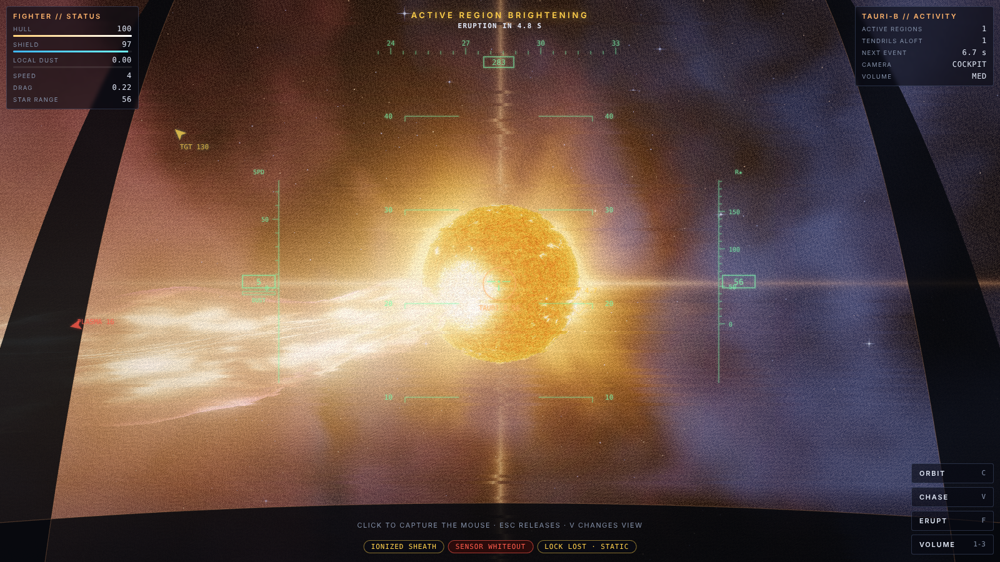

## Flight

The fighter never stops. The throttle sets a cruise speed between 34 and 95, and the engine holds it against the dust: dense dust still drags you below cruise, but never below 28. Shift boosts to 1.8× cruise. At the edge of the nebula the ship comes about on its own, turning harder the deeper you go, the way Deckrunner's ship swings round at the end of the hull.

Game speed slows or speeds the whole simulation: bandits, rounds, your own rate of fire, eruptions and shock fronts. 100% is the default and sits mid-slider; it runs the sim at a quarter of its raw rate, which is where it plays well. The slider goes from 40% to 160%. The stick and throttle stay at real-time rates, so at lower speeds you have more time to line up shots and dodge. The setting is kept in the browser between sessions.

## Combat

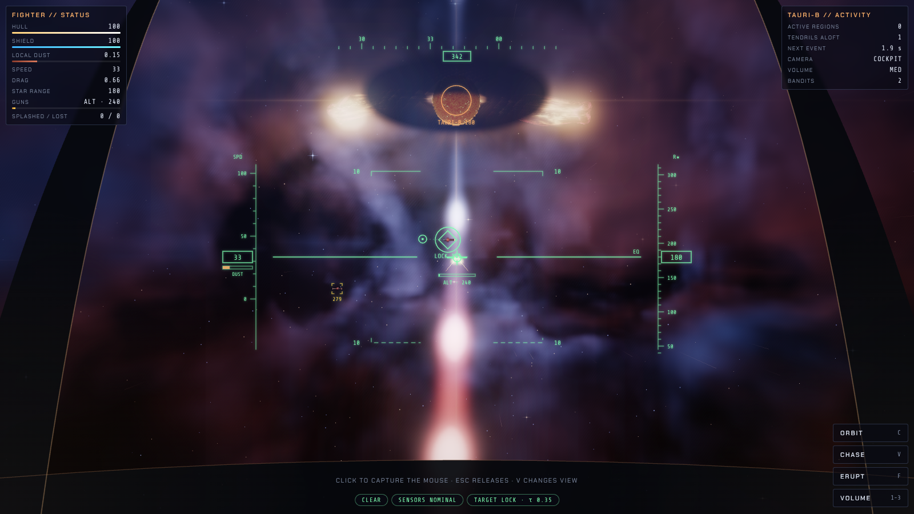

**Guns.** Kinetic only, ported from Deckrunner. Four ports converge at the convergence range: alternating pairs fire fast, the linked quad fires all four at 1.5× damage, more slowly. Every shot adds heat; at 100 the guns lock until heat falls below 35. Rounds travel at 900 u/s for 0.8 s and inherit the ship's velocity. Hits are swept-segment tests from each round's previous position to its current one, so fast rounds can't tunnel through a fighter.

**Bandits.** In free flight, two at a time, respawning 5 s after a kill; sorties set their own count and toughness. The airframe is a space-going close-support brawler on the A-10 pattern: straight thick wings with drooped tips, twin engine pods carried high on the aft fuselage, twin tails, and a rotary cannon out of the nose. It is slower and tougher than the player (10 hit points), and fires 6–9 round bursts from the nose gun. A small light kit makes it read at range: flickering engine exhausts, red wingtip navs, a double-flash tail strobe and a faint cockpit glow. Each one flies the same arcade model as the player: velocity follows the nose, and dust is drag. Its turn rate is limited and it rolls into its turns.

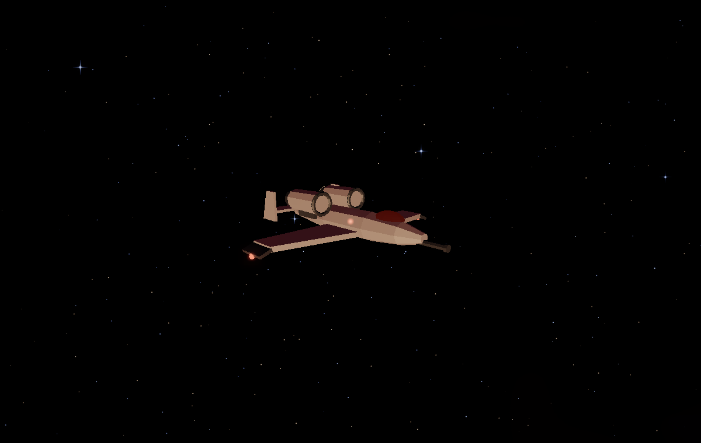
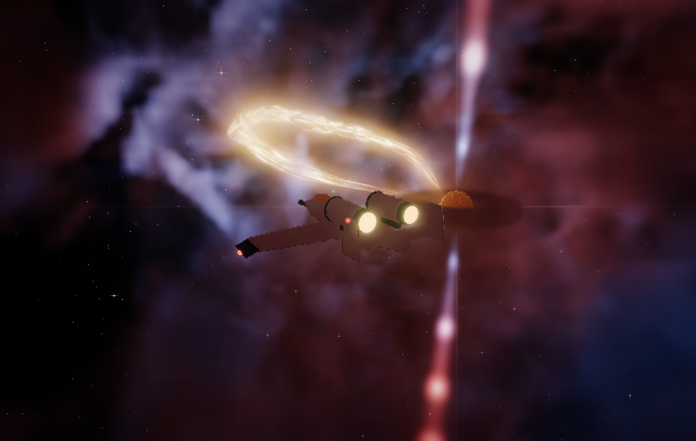

- **Attack.** Lead pursuit on its own firing solution. It fires 4–6 round bursts when its nose is within about 7° of the solution and inside 430 units.
- **Extend.** After an overshoot or a close pass, it breaks off along a random heading for 2–3.5 s, then comes back around.
- It keeps clear of the star and stays inside the nebula.

**Interference cuts both ways.** Bandits run the same environment checks as the player: shock fronts shove them and drain their hit points, plasma and the jet core burn them, and a kill by the star is announced. Their own static scales their aim error from 0.6° to almost 10°, and above 0.8 they hold fire. They also need an optical depth under 1.3 along the line to you, so dense dust hides you. For the player, the lock (optical depth under 1.0, static under 0.45) gates the lead pip. The pip wanders as static climbs, and without a lock you fire down the boresight.

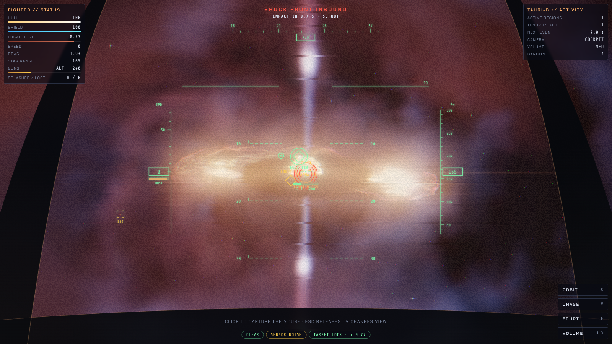

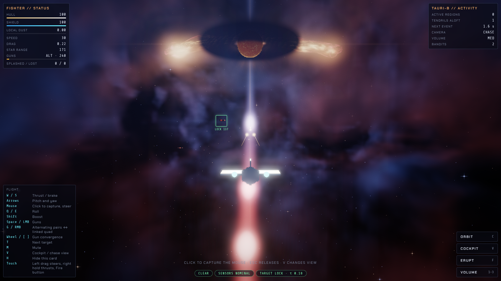

**Tracers and effects.** Tracers and sparks are 1-pixel lines, too thin for the half-resolution volume to resolve their depth. They render into their own target with colors pre-dimmed by a CPU optical-depth march from the camera, and are added after the composite. So a burst fired into thick dust fades the way the dust says it should, and bloom still picks it up.

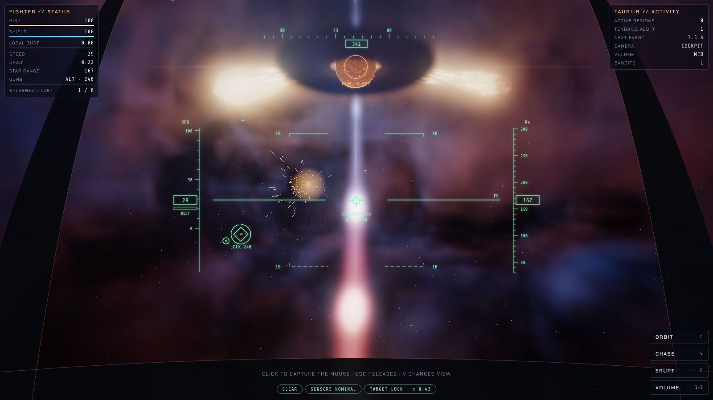

**Sound.** Small WebAudio synthesis: guns, hits, rounds cracking past the canopy, explosions, and a static bed whose hiss and crackle follow the interference level.

## The station

The final-sortie set piece (Terminus), in the spirit of Deckrunner's starbase. In free flight, K or the Station button puts it on scope.

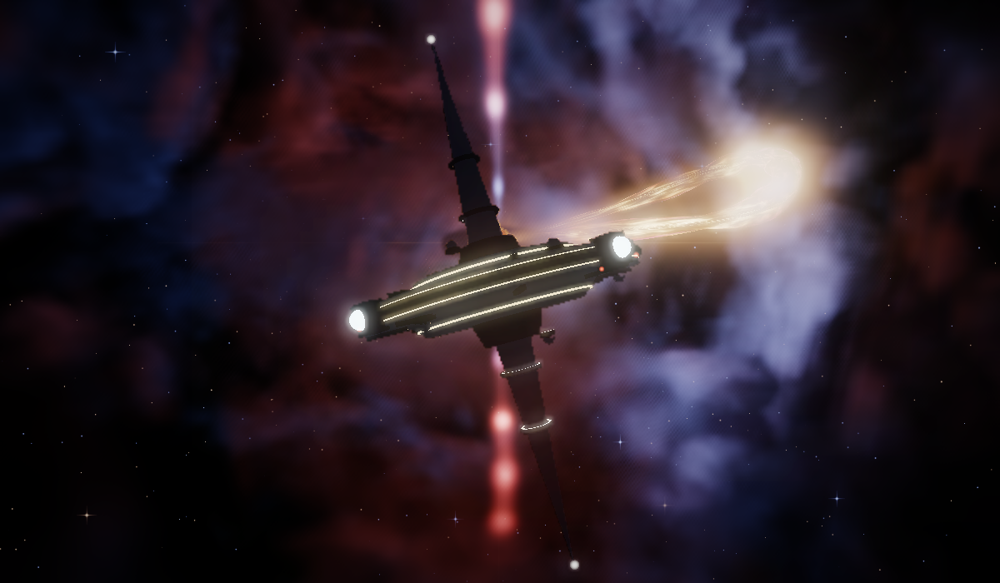

- **Structure.** A 68-unit disc with stepped decks, spike pylons out of both faces with collar rings and beacon tips, window bands, and running lights around the rim. It spins slowly on its axis, about 150 units out from the star.
- **Guns.** Eight turrets: three on each deck face and one on each pylon collar. They track you, lead on your relative velocity (including the station's spin), and fire short bursts. They follow the same rules as bandits: dust line of sight, aim error that grows with static from shock fronts sweeping the station. A turret can't fire through its own deck.
- **Reactors.** Four glowing cores on the rim, 40 hit points each. You have to fly the edge to reach them.
- **Hull.** Solid. Your rounds stop on it, and so do theirs, so the disc is cover. Flying into it scrapes you off with damage.

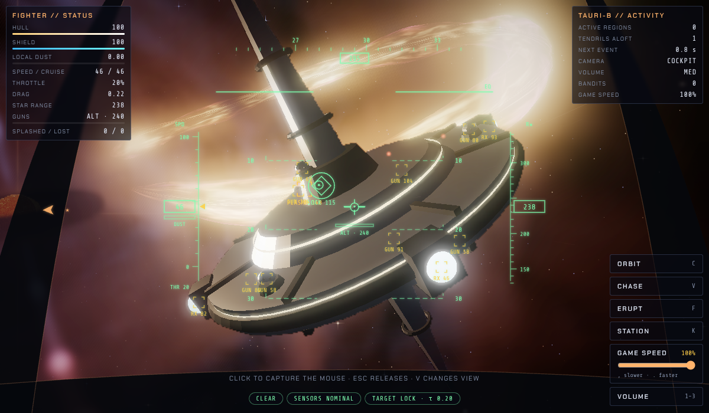

**The last reactor kills the power.** The lights and windows go dark, the guns die, and the spin bleeds off. Pushed off station-keeping, the station starts falling toward Tauri-B and tumbling. Secondary explosions run across the hull. Inside about 110 units the hull starts to glow and shed burning debris. About 13 seconds after the last reactor, it is consumed in the corona in one large flash, and the star answers with an eruption.

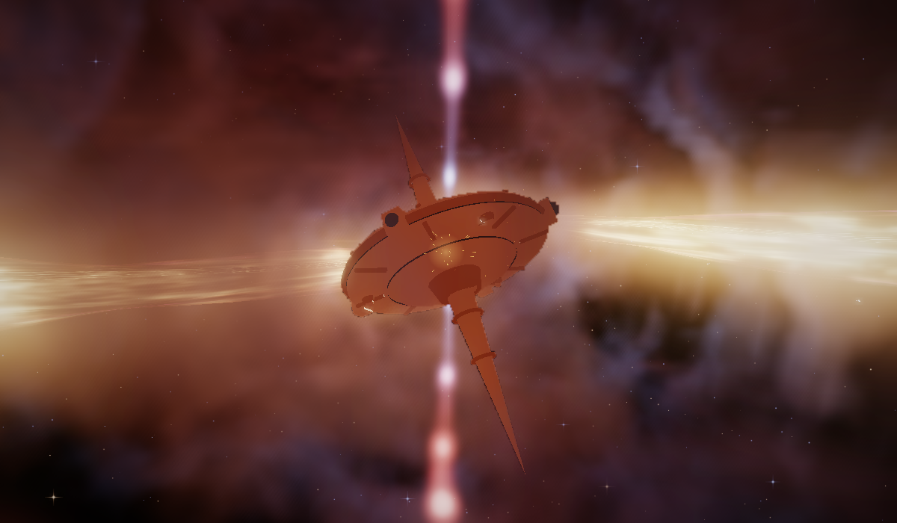
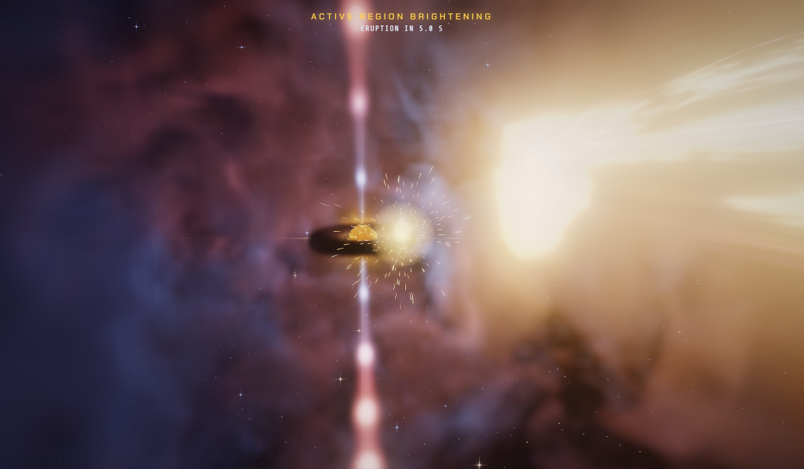

## Skirmish (Six Fleets)

`skirmish.html` is the real-time engagement: any two of the six cruisers, you against the computer, in the same nebula. Shock fronts from the star's eruptions push the ships about.

**Height.** The ships climb and dive. The hull pitches up to 30° while it changes height and levels out when it holds it, so it stays a ship flown on its deck, not a fighter; heights are kept within 110 units (27 hexes) of the star's equatorial plane. The tactical engine still sees a flat map: range is the true distance between the ships, and a bearing is the direction to the other ship in the shooter's level frame with the height difference dropped, so arcs and shield facings work as on the sheets. Within 15° of straight above or below, a ship (or a seeker) keeps the bearing it had as it crossed into that cone: a hit from top dead centre lands on the facing it was approaching from. The computer captains pick a height to fight at and change it now and then, climb or dive away when they break off, and change height to dodge an incoming seeker.

**Rapid speed turn.** Two ships of equal speed can't shake each other: once one is on the other's tail it stays there. As in the tactical game, a ship can throw away its speed and spin on the spot: Q (↻ on touch) bleeds the speed to almost nothing over about two and a half seconds while the turn rate climbs as it slows, enough to come right round, then the ship accelerates out on its new heading. Hold A or D to steer the spin; with neither held it brings the bow round on the target. Each ship has two a fight (the HUD shows what's left). The computer captain uses one when the enemy has sat aft of it for six seconds without the range opening, and only if its weapons would rather have the enemy forward. `?nosnap` takes it away (for A/B sweeps); `?snaps=N` sets the count.

**Self-destruct.** A beaten ship with an enemy sitting on it can take the enemy with it. Hold X (SD on touch) for a second and a half; letting go cancels, and the HUD counts it down. The ship goes up at once and the blast lands on the enemy as one volley of 36 on the shield facing the wreck, through the tactical engine like any hit: full strength out to 2 hexes, half at 3, a quarter at 4, nothing beyond. The computer captain does it when it is beaten (half its boxes marked, or every weapon but point defence gone), its shield toward the enemy is down and the enemy is within 2 hexes. Your own self-destruct is a loss, or a mutual kill if the blast finishes the enemy. `?nosd` takes it away.

**Radar.** Bottom left, heading-up with your ship at the centre: rings at 10, 20 and 30 hexes, the edge at 40 (an enemy further out sits on the edge, hollow, with its range). The enemy is a red triangle pointing the way it is heading, with its height above or below you in hexes; seekers are dots, orange coming for you and blue yours. The shaded sectors are where your armed weapons bear, so it shows which way to turn; the faint spokes are your shield facings' edges. When the enemy is off screen or behind the camera, a red pointer on the screen's edge shows where it is, with the range. Both are HUD, so recordings and photos don't carry them.

**Burning breaches.** A hull hit that goes internal leaves a breach. It burns as open flame for six seconds after the hit, dies back over a second and a half, then smoulders as sparks and flickering embers, more of both on a badly damaged ship. Another hit on the same breach lights it again.

**Picking the pair.** The page opens on a picker: your ship, the opponent, then Launch (Enter), or Watch to put the computer at both helms. Any pairing works, the same class on both sides included (the opponent is then the hull's second ship, with its own damage record). The choice goes into the address (`?p=raptor&e=sentinel`, with `&auto` to watch), so Fight again replays it and a link opens straight into it; Change ships on the end screen goes back to the picker. The ship names are `sovereign`, `reclamation`, `pathfinder`, `sentinel`, `vanguard` and `raptor`; `?auto` alone fights the Sovereign against the Reclamation.

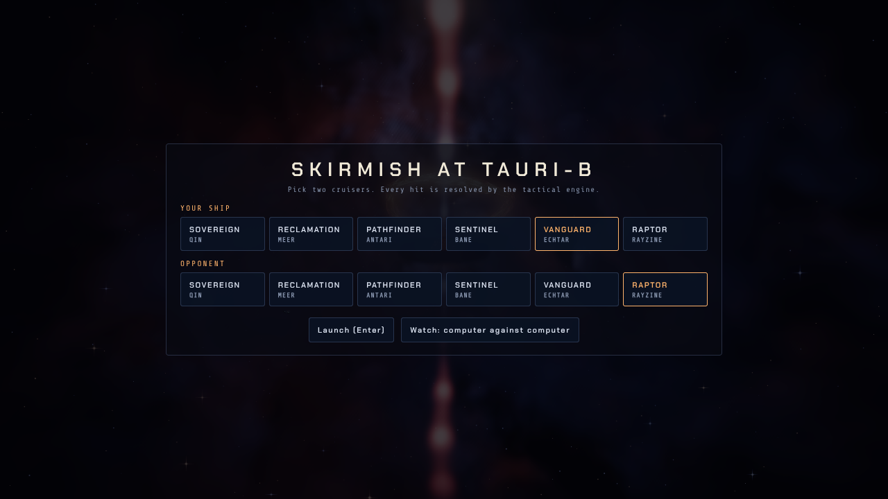

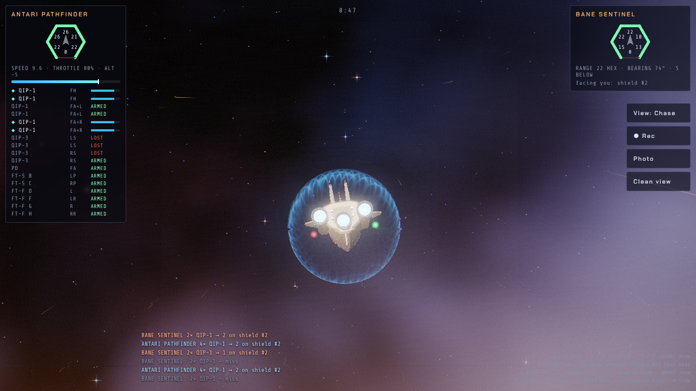

The battle does not decide damage. Every shot is rolled by the tactical engine's `weaponShot()`, and every hit is marked by its `resolveVolley()` (`resolveEnveloping()` for the Helios Lance, `resolveSplash()` for the Particle Driver) on the same damage state the tactical game uses. `js/bridge.js` is the adapter: true range in hexes (4 film units to a hex), and the other ship's bearing from the bow, which it turns into a hex for the engine's own arc test and shield choice. Weapon mounts are placed from the tactical ship sheets: each weapon box, scaled bow to stern onto the model's main hull and dropped onto its upper surface. A destroyed weapon stops firing; a downed shield facing lets hits through to the hull.

Fire control runs on tactical turns of 8 seconds: projectors recharge every turn, a missile rack launches once a turn, quantum torpedoes, ion shear cannons, particle drivers and lances arm in two, and fusion torpedoes take their size's arming stages (power.js). Weapons start armed. Power allocation is not modelled yet.

**Seeking weapons.** Fusion torpedoes fly at their tactical speed (32 hexes a turn) and steer for the target. Missiles would come out at 10 units/s from their tactical 20 hexes a turn, slower than every cruiser (11 to 13 units/s), so they could only hit a ship flying at them; they fly at 14 units/s instead, just faster than the fastest cruiser, and burn out sooner, so their reach is still the tactical 60 hexes (`?asmspeed=N` sets the speed). A missile is drawn as a body, a slim hull with a nose and four fins flying nose-first, a small white drive flame and a long thin pale trail; a fusion torpedo is a ball of orange plasma with no body. A fusion torpedo's warhead is the engine's `plasmaWarhead()` for the hexes it has flown, so running from one weakens it; a missile carries a warhead of 8 (its type's is 12; `?asmdmg=N` sets it) until it burns out, and a rack holds what its spaces hold (four to a type-A rack; reloads are not modelled). Once missiles can catch a ship, the Raptor's four racks killed inside 40 seconds, so in the skirmish only three of them are loaded (`?raptorracks=N`, 1 to 4); the Vanguard keeps its two. Three racks at the full 12 still wiped a human player out, so the warhead came down to 8 as well, and an amber banner now calls seekers aimed at you (count and nearest range from 30 hexes; inside 15, where the computer captain dodges, CLIMB OR DIVE NOW), with pulsing marks on the radar.

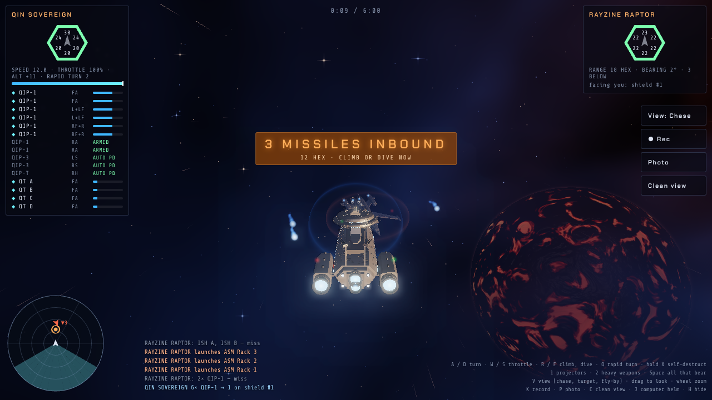
 On reaching the shield the warhead is marked by `resolveVolley()` on the facing it comes in on. Short-range projectors (QIP-3) shoot at a seeker inside 3 hexes if they are armed and bear: a missile dies to its damage rating, a fusion torpedo loses half the damage done from its warhead. They hold fire on ships, except the Rayzine Raptor's ten, which are its close-in punch and fire on ships too (`?raptorpd` holds them like everyone else's).

**The ships.** The Sovereign and the Reclamation use the film's builders. The other four are dressed from their Shipyard models: shield and hull extents from the model's bounds, drives at the Shipyard's drive discs, and colours per race for drives, decks, shields and beams. Mounts come from each hull's tactical sheet as above; the Vanguard, with no single main hull, maps its sheet onto the bounds of the whole V.

**Locations.** The picker (and `?loc=`) offers three places to fight, and the saved result records which:

- **Tauri-B** (`tauri`, the default): in the nebula by the star, as before. Veyrath hangs beyond the nebula as scenery, lit by the star and dimmed by the dust in front of it (`?noplanet` leaves it out).
- **Veyrath** (`veyrath`), Tauri-B I, a volcanic world, and **Caelora** (`caelora`), Tauri-B II, an oceanic world: the fight is in low orbit. The nebula and the eruptions are off, and Tauri-B is the distant sun, high on the left. The planet takes the star's place as the hazard: its edge is the sphere's cross-section at a ship's height (the centre sits 850 below the fight, so the surface is nearer the deeper you dive), with the same warning banner, computer avoidance and loss as the star.

**Reflections.** Each location builds a small sky (the nebula's colours at Tauri-B; the sun and the planet below in orbit) and prefilters it into `scene.environment`, so the hulls are polished metal that mirrors where they are: hull metalness 0.8 / roughness 0.3, trim 0.9 / 0.24, ambient light cut while it is on. `?noenv` turns it off for comparison. Left without, right with (Caelora above, Tauri-B below):

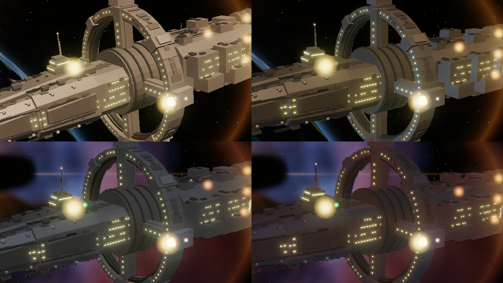

**Hull detail.** The hulls carry plating drawn in the shader: the models have no UVs, so the pattern is projected from three sides in the ship's own frame (it runs on across parts and stays put as the ship turns). Staggered panels about 1/26 of the hull's length; seams darken and roughen; each panel varies a little in tone and polish, which breaks the reflections up plate by plate; slow grime over it; and a few panels carry a thin light strip in the ship's shield colour. Seams fade out before they can shimmer at a distance. `?nodetail` turns it off. Without and with, on the Reclamation over Caelora:

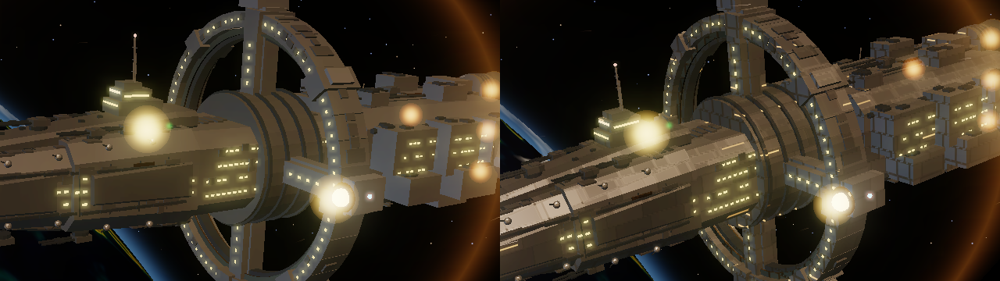

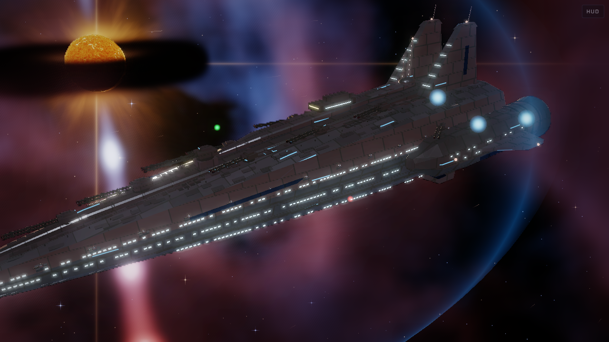

**Baked shadowing and drives.** `shipkit.py` bakes a small 3D occlusion field for each hull when it exports the model (`<model>.ao.json`, about 64 cells along the hull; `python3 shipkit.py --ao *.glb` re-bakes from existing models), and `tools/embed_hulls.py` embeds them as `#film-ao`. The hull shader samples it just off the surface, so creases darken however big the faces are: the surface colour and the reflected and ambient light dim where hull crowds in. The drive exhausts, flat over-bright discs before, are split into their discs at launch and drawn with a heat gradient (white-hot core, the race's drive colour, a dimmer rim, a slow flicker). `?noao` and `?nodrives` turn them off. Before and after (Sentinel at Tauri-B, Reclamation over Caelora), then the drives:

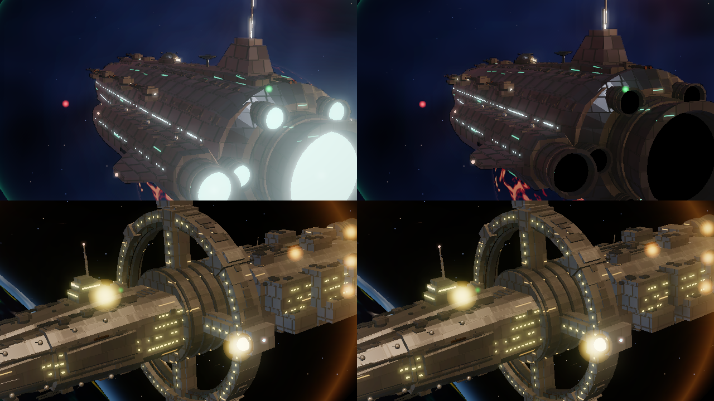

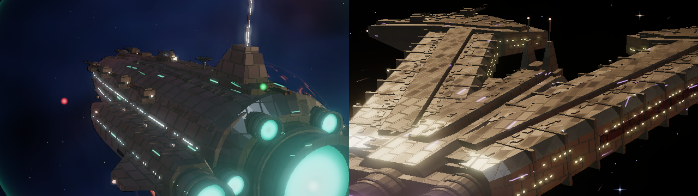

`SK.debug.hold(x, y, z, fov)` pins the camera at an offset in the player's frame for headless stills (`hold()` lets go).

The planets are drawn by `js/planet.js` from maps baked offline from Deep Space's terrain functions (`tools/planets/` at the repo root) and embedded by `tools/embed_planet.py`, so the page still runs from a plain file. Both planets add about 4 MB to the page (8.9 MB in all).

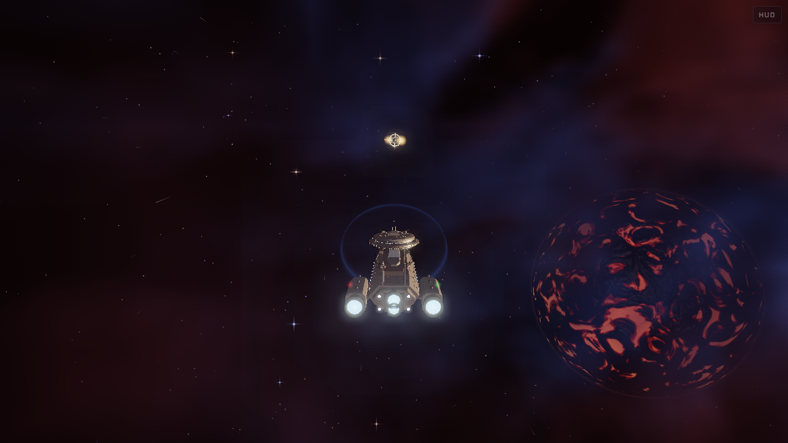

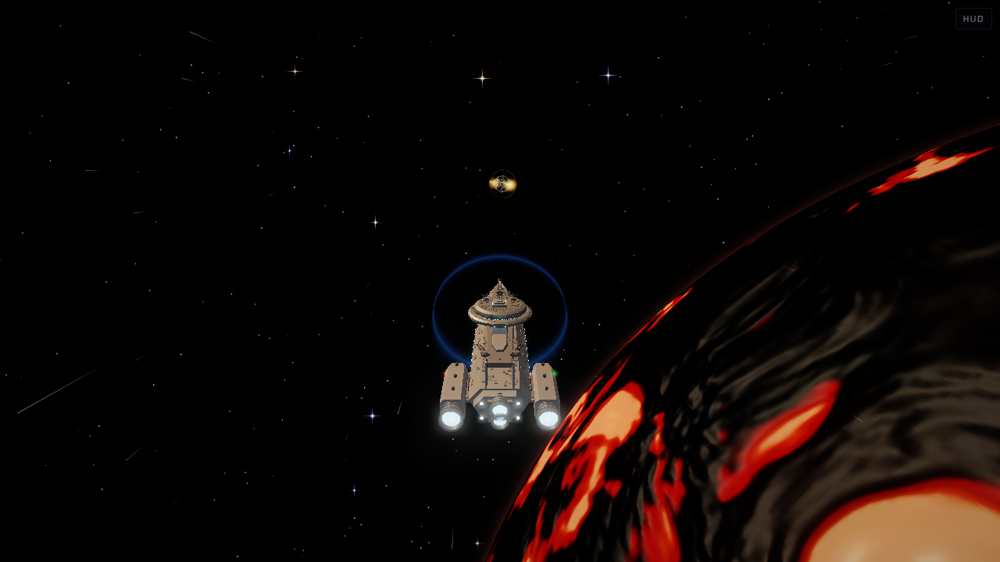

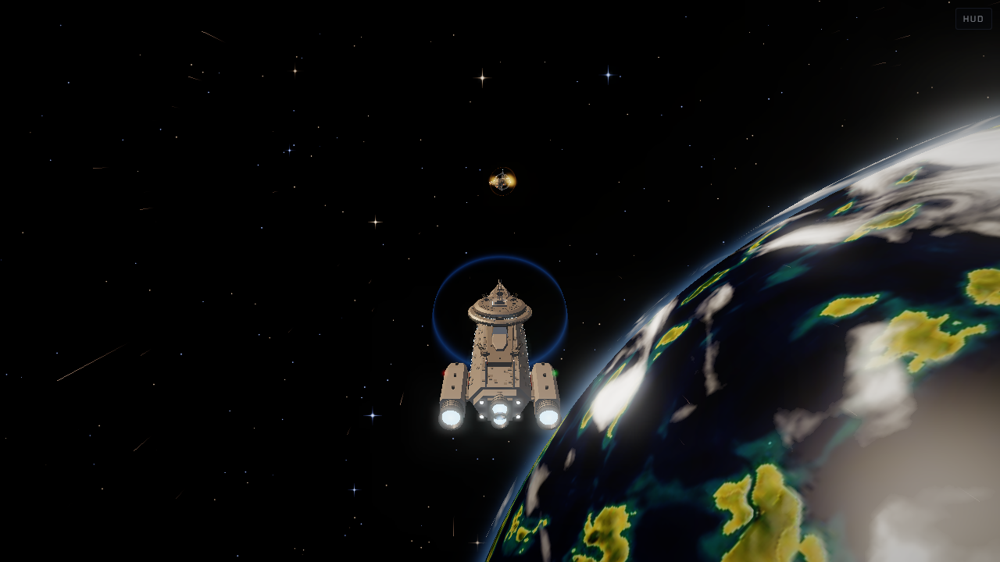

The fight ends when a ship is destroyed, the range opens past 100 hexes, or after six minutes. The end screen shows both ships on their tactical sheets, drawn by the engine's `sheet.js`, and **Save result** downloads the damage state as JSON (`six-fleets/engagement-result`), the record the campaign layer will read.

Controls: A / D turn, W / S throttle (the bar under the speed shows the setting, its white mark the speed reached), R / F climb and dive (the HUD shows your height and how far above or below the target is, in hexes), Q rapid speed turn, hold X to self-destruct, 1 projectors, 2 heavy weapons (torpedoes, cannons, lances and missiles), Space everything that bears, V cycles the camera (chase, target, fly-by), drag to look, wheel to zoom, J hands the helm to the computer, H hides the key list. On touch, button rows for helm (with ▲ ▼ for climb and dive, ↻ for the rapid speed turn, SD held for self-destruct) and fire. `?auto` starts with the computer at both helms.

Capture: K starts and stops a recording of the 3D view (MP4 where the browser can encode it, otherwise WebM; the HUD is never in it), P saves a PNG of the view, C hides the HUD for framing (the small HUD button brings it back). The same three are buttons under View. Fly-by parks the camera ahead of your ship and lets it pass, re-parking as it goes. A recording that comes out empty is not downloaded; the next one uses another format.

Building: `skirmish.html` is assembled by `tools/build_skirmish.py` from `index.html`, the film's shared ship code in `engagement.html`, and `src/skirmish_core.js`; it then embeds the hulls (`tools/embed_hulls.py`: all six in the skirmish, the film's two in the film) and the planets (`tools/embed_planet.py`). Edit the sources and rebuild, from `battle/`:

```
python3 tools/build_skirmish.py
```

`window.__sk` has `simulate(seconds)` (runs the fight without drawing), `info()`, `result()` and `debug` (`bear()` and the two ships) for headless checks. `test/bridge_test.js` checks the bridge against the real engine (from the repo root: `node battle/test/bridge_test.js`).

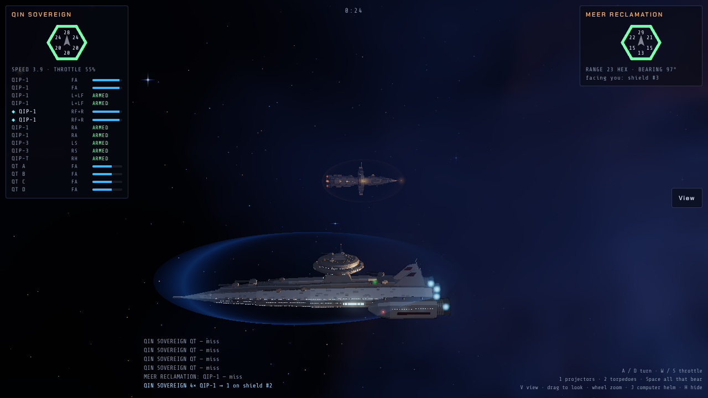

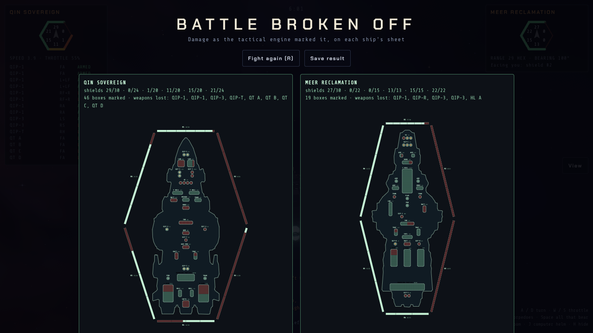

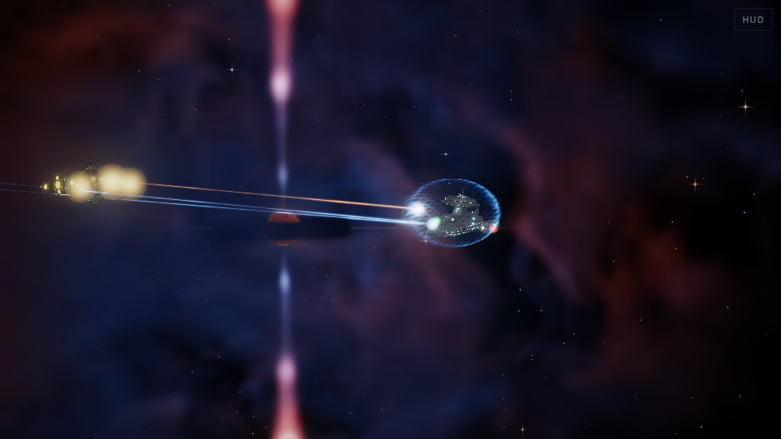

## Engagement at Tauri-B (film)

`engagement.html` is an 84-second scripted film on this engine: the Qin Sovereign and the Meer Reclamation trade fire in the nebula while the star erupts; a shock front breaks up the fight, and the Sovereign's last torpedoes find the Reclamation with its shield down. It burns, and its reactor goes. The volume, eruptions, shock fronts, sparks, bloom and interference are the game's own. Hull hits, burning breaches and the Reclamation's death use the skirmish's effects (a copy of that code in the film, kept in step by hand). The film adds the two capital ships, their shields, beams and torpedoes, and a camera director.

The fight is at the skirmish's ranges: the Reclamation closes from about 50 hexes, holds 32 to 36 through the exchange and opens to about 45 by the kill (it used to sit about 10 off, a ship length and a half). The shots are built on that gap: long lenses over each ship's shoulder with the volleys and lances going out across it, a camera riding the first torpedo over, a wide profile with the two ships far apart against the star, and the kill seen from above the Sovereign through the dust before cutting in close. The hulls wear the skirmish's look (`js/shiplook.js`: the nebula's sky to mirror, plating, baked occlusion, drive exhausts). `CIN.tau([x,y,z],[x,y,z])` gives the dust between two points, for checking a long shot's line of sight headlessly.

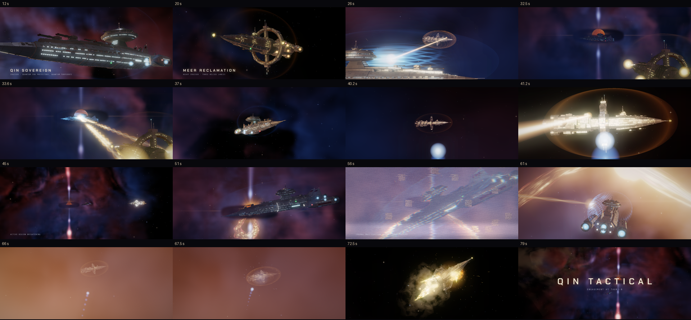

The hulls are the Shipyard models (`../shipyard/assets/qin-sovereign.glb` and `qin-reclamation.glb`), scaled 2.5 film units per 100 m so they keep their canon sizes (30.5 u and 24.5 u). The Meer refit of the Reclamation burns orange drives with amber decks and carries three Helios Lance emitters: the bow lance and the forward faces of the drive ring's pylon caps. Turret, drive, shield and nav positions sit in `buildSovereign()` and `buildReclamation()` in model units.

The two hulls are embedded in the page, so the film runs when opened as a plain file (a `file://` page cannot fetch the `.glb` files). After rebuilding either model in `shipyard/assets/`, refresh the embedded copies from `battle/`:

```
python3 tools/embed_hulls.py
```

Controls: Space plays or pauses, R restarts, arrows seek 5 s, L letterbox, C captions, H hides the bar, 1-3 set volume quality. `?t=SECONDS` starts at a time and `?still` holds there; `window.__cin` exposes `seek(t)` and `info()` for headless captures.

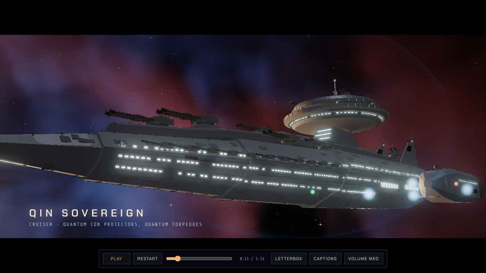

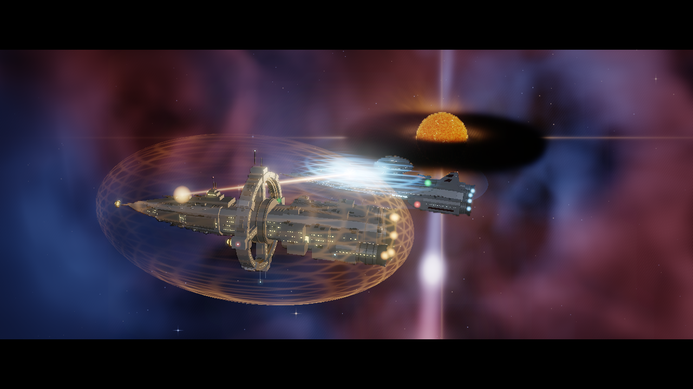

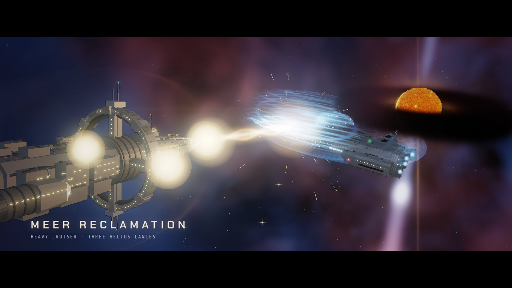

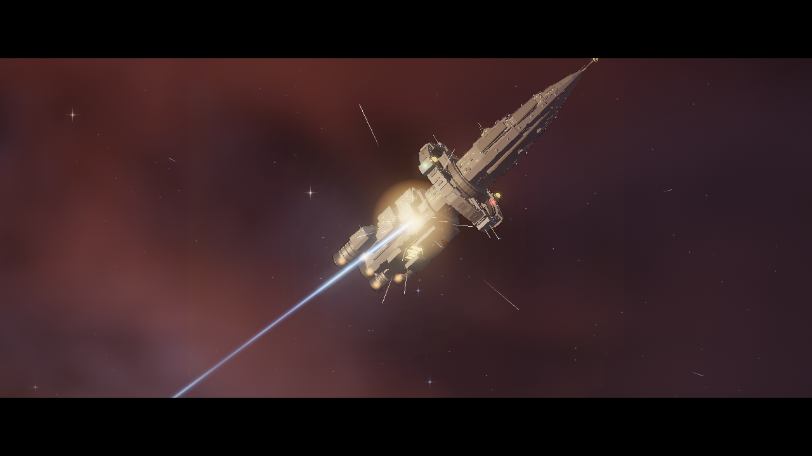

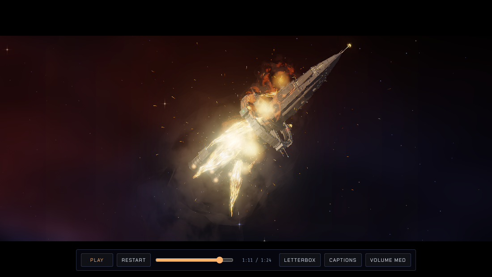

## How it works

### One environment, read by both the renderer and the game

At startup the page bakes a 96³ density grid from warped fbm noise (about 0.6 s, sliced across frames so the page stays responsive). The grid is kept twice:

- a `Float32Array` on the CPU, which gameplay reads, and
- the same values uploaded as an RG8 `Data3DTexture`, which the volume shader raymarches. R is dust density, G is tint (red emission gas versus blue reflection dust).

Because both sides read the same field, what you see is what you get:

- **Drag.** The fighter's drag is the dust density at its position.
- **Line of sight.** The target lock integrates optical depth along the line to the target through the grid, using the same absorption constant as the shader. Dust you can see between you and the target breaks the lock. Bandits use the same march to decide whether they can see you.

### The volume

The nebula is not geometry. A full-screen pass at half resolution casts a ray per pixel, clips it to the nebula sphere and to the opaque scene's depth buffer, and steps along it, accumulating emission and absorption. Each step samples:

- **the density texture,** plus a small tileable detail texture for fine structure. The detail is cosmetic and gameplay ignores it.
- **one extra density sample toward the star,** a cheap self-shadow. Dust faces lit by the star get bright rims; dust behind other dust stays dark.
- **the tendril field,** described below.

A composite pass combines the result with the scene: `scene * transmittance + emission`. Bloom and ACES tone mapping follow.

### The star: eruptions, jets and a disk

The star's activity is modelled on what real young (T Tauri) stars do.

#### Coronal mass ejections

Each eruption runs through four phases:

1. **Warn (3.6 s).** An active region on the surface brightens and flickers. This is the telegraph. In fly mode, the HUD tells you if you are inside the cone the eruption will sweep.
2. **Rise (2.8 s).** A magnetic loop lifts off between two footpoints and arches outward.
3. **Erupt.** The loop becomes a flux rope and inflates while its legs stay anchored to the footpoints, giving the classic "lightbulb" CME shape. Between 1.6 and 3 s its legs reconnect and the rope detaches into a closed ring that keeps expanding outward. Ahead of it runs the **shock front**: a spherical cap centred on the eruption site that lights the dust as it sweeps through.
4. **Fade.** The rope and front dim as the ejection leaves the nebula.

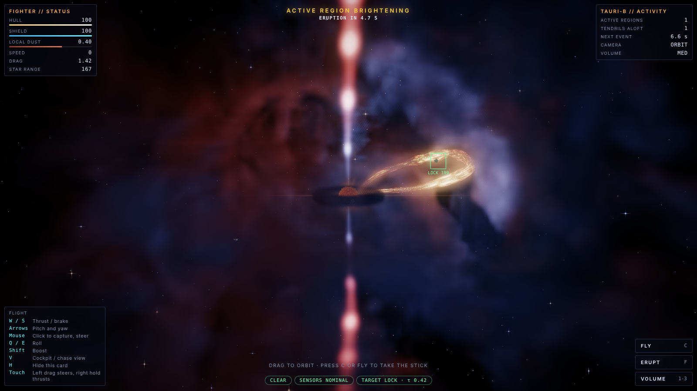

#### Bipolar jets and the accretion disk

- **Jets.** Two collimated jets run along the spin axis. Knots (Herbig-Haro knots) travel up them at 38 u/s, and each jet ends in a bow shock where it rams the cloud. The jets are thinner than a raymarch step, so the shader integrates each one analytically: the gaussian cross-section is evaluated at the ray's closest approach to the axis. The bake carves outflow cavities into the density grid along the axis, with dense walls.
- **Accretion disk.** A flared disk, with its inner rim at 12 units, sits in the equatorial plane. It is sub-sampled where rays cross it. Seen edge-on it reads as a dark lane across the star, which is the look of HH 30.

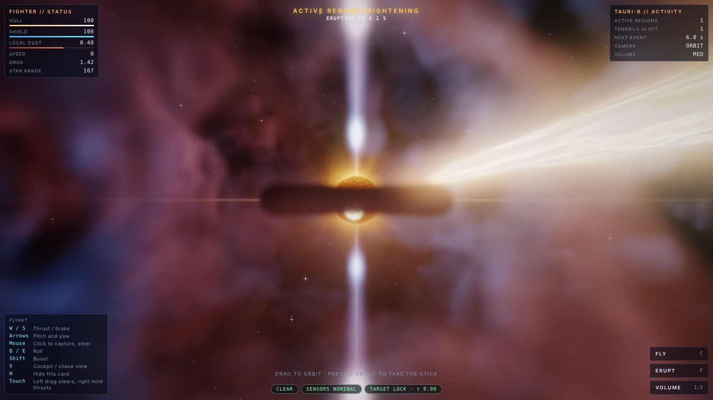

#### Shared data, hazards and interference

Each eruption's rope is 9 control points, recomputed on the CPU every frame. Its front is a centre, radius and cone. Those same values drive the tube, the volume shader and the hazard checks:

- **Plasma contact** with the rope damages the hull directly.
- **The ionized sheath** around the rope drains shields.
- **A shock front** shoves the ship outward and drains shields as it passes.
- **The jet core** is lethal and throws you along the axis. The jet flanks cause interference.

Interference escalates with how close the shock front is (e-folding every 45 units), not just on contact:

1. **Snow and tearing** come first.
2. **Rolling sync bars, scanlines, color fringing and block dropouts** follow as the front closes.
3. **Frame jumps and white-out frames** hit at impact.

The HUD shows a shock marker with an impact countdown and `BRACE` inside 60 units. Its symbology jitters and drops out with the static, while the canopy holds still.

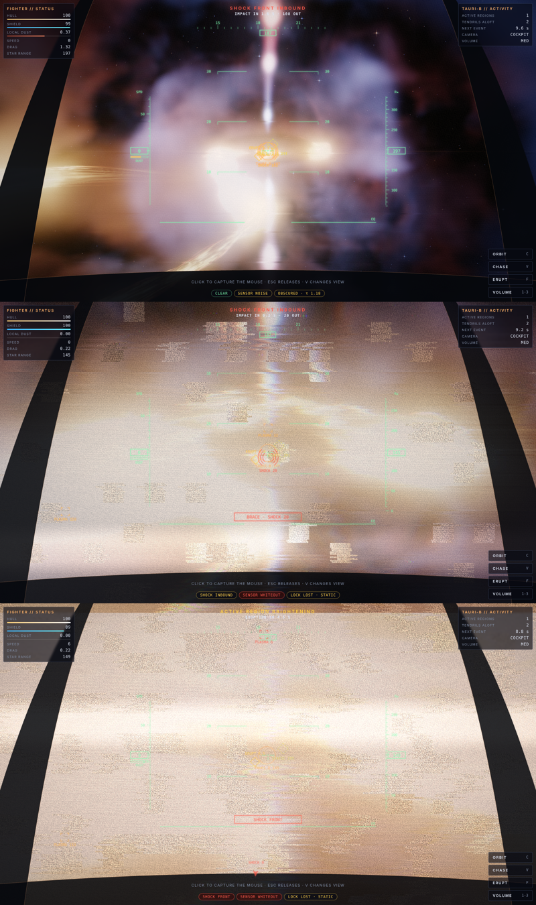

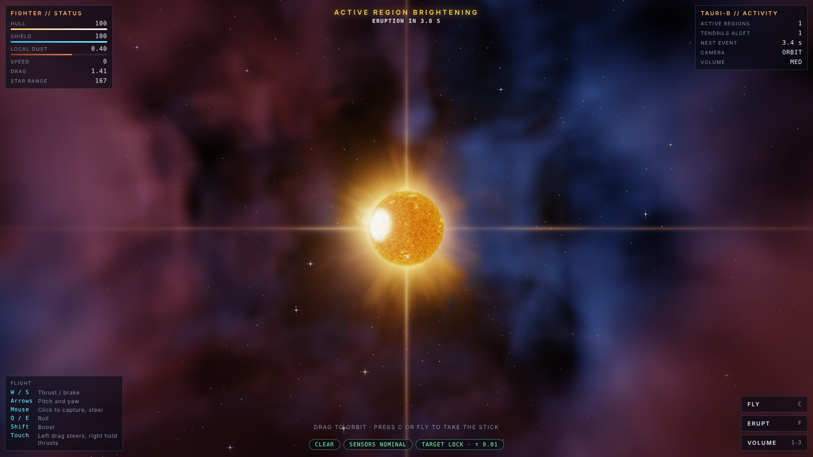

## Performance knobs

| Quality | Volume resolution | Steps per ray |
|---|---|---|
| Low (touch default) | 1/3 | 36 |
| Medium | 1/2 | 56 |
| High | 1/2 | 96 |

Ray start is dithered per pixel, which turns step banding into fine grain.

Requires WebGL2, because of the 3D textures.
